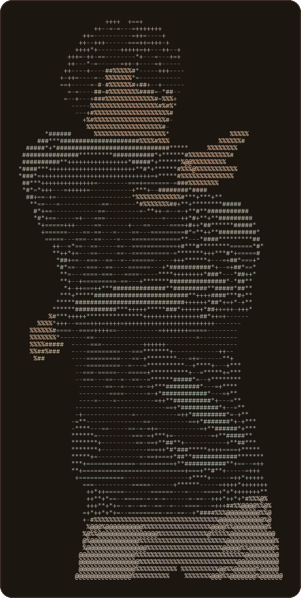

# Hi, I'm Franco. 👋

**Data Scientist · Applied Researcher · Human Being**     
*I like experiencing things I know nothing about*

This is the source of my personal website, **[funkey08.github.io/hi-im-franco](https://funkey08.github.io/hi-im-franco/)**. I built it from scratch to introduce myself. It's a warm, lamp-lit lab bench where my name is a working nixie-tube instrument. The design is inspired by Steins;Gate, my favourite anime of all time.


<br clear="right">

## Built with

React 19 · TypeScript · Vite 7 · Tailwind CSS v4 · Framer Motion · React Router 7 · Canvas 2D (the neuron simulations) · SVG (the map) · GitHub Pages

## Development

```bash
yarn            # install
yarn dev        # local dev server at http://localhost:5173/hi-im-franco/
yarn build      # production build to dist/
yarn lint       # ESLint
yarn deploy     # build, then publish dist/ to the gh-pages branch (the live site)
```

Deep links like `/work` work on GitHub Pages through the `public/404.html` redirect.

## Where things live

| Path | What |
|---|---|
| `src/data/` | **All the copy and numbers**: readings, projects, roles, awards, facts, countries, books, etc. |
| `src/pages/` | `home/`, `work/`, `life/`, and the 404 page |
| `src/instrument/` | The nixie-tube state machine and the provider that runs readings and page transitions |
| `src/components/` | Clock, dock, footer, intro, cursor, lightbox |
| `src/sims/` | Canvas simulations: the neural net (Work) and the biological neurons (Life) |
| `src/legacy/` | The original site (still reachable at `/legacy`) |
| `scripts/` | Asset builders (Python + Pillow): ASCII art, Life photos (resized, location data stripped), world map, this README's portrait |
| `docs/` | Design history, decisions log, mockups and source art ([`docs/README.md`](docs/README.md)) |
| [`TODO.md`](TODO.md) | The current design and what's next |

The original site is preserved exactly as it was in the `archive/original-site` branches and the `v1-original-site` tag.

---

Thanks for stopping by. *El Psy Kongroo.*
