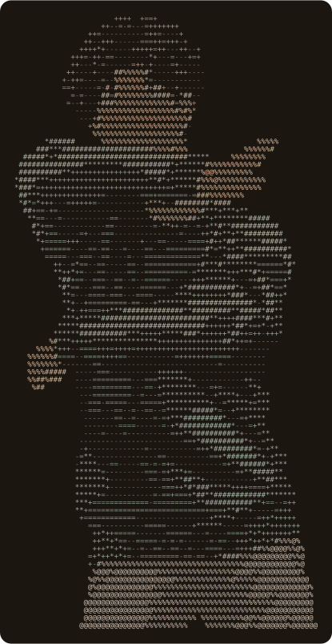
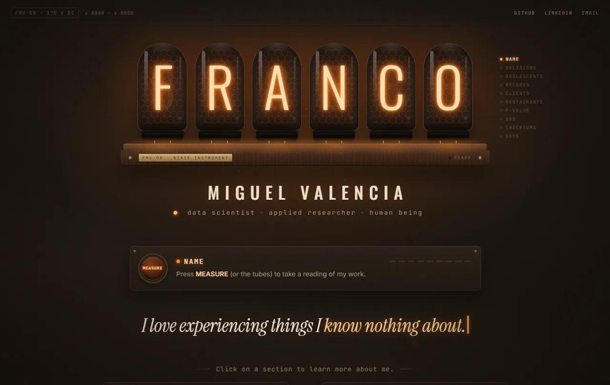
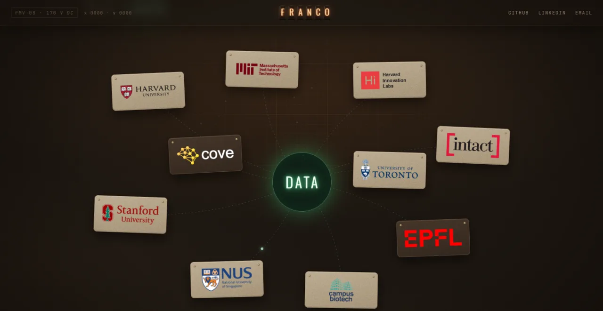
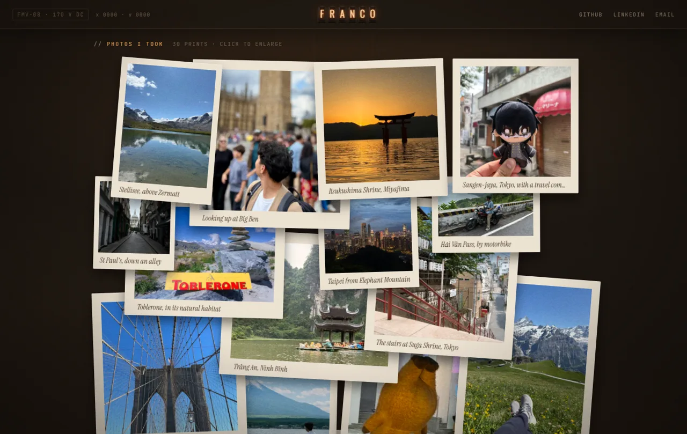

<div align="center">



# Hi, I'm Franco.

**data scientist · applied researcher · human being**

*I like experiencing things I know nothing about.*

[**funkey08.github.io/hi-im-franco**](https://funkey08.github.io/hi-im-franco/)

</div>

---

This is my personal website, built from scratch. It's designed as a warm, lamp-lit lab bench: my name is a nixie-tube instrument, and the readings it takes are real numbers from my work.

<p align="center"></p>

## What's inside

- **Home.** `FRANCO` in six nixie tubes. Press **MEASURE** (or the tubes) to cycle through measurements from my projects: decisions modelled, records parsed, a p-value, a study's total cost. The last reading is a Duolingo streak that ticks up every night. Then: a carousel of recent experiments, and two channels into the rest of the site.
- **Work.** Every institution I've worked with, wired to a single node (*data*), followed by experience, awards, my tech stack and lab-notebook cards for each project, with figures, tools and links.
- **Life.** Things I'm proud of (some serious, some not), a map of the 17 countries I've been to, photos I took, scattered like prints on a desk, and the books I love.
- **Details.** A short "worldline" boot sequence while the page loads, the tubes docking into the header as you scroll, neural-network (Work) and biological-neuron (Life) animations that fire in causal order, and a few quiet easter eggs.

<p align="center">
  
  
</p>

## Built with

React 19 · TypeScript · Vite 7 · Tailwind CSS v4 · Framer Motion · React Router 7 · Canvas 2D and SVG · deployed on GitHub Pages.

No UI kit and no backend: the animations, map and layouts are written by hand, and the contact box opens your own email app.

## Running it locally

```bash
yarn            # install
yarn dev        # dev server at http://localhost:5173/hi-im-franco/
yarn build      # production build to dist/
yarn lint       # ESLint
yarn deploy     # build and publish dist/ to the gh-pages branch (the live site)
```

## Where things live

| Path | What's there |
|---|---|
| `src/data/` | All copy, numbers, projects, facts and books, as typed data. Edit these, not the components. |
| `src/pages/` | Home, Work and Life. |
| `src/instrument/`, `src/components/nixie/` | The nixie-tube instrument. |
| `src/sims/` | The neural-network and neuron canvases. |
| `scripts/` | Asset builders (need Python + Pillow): `make_ascii.py` (ASCII portrait), `make_life_photos.py` (resizes photos and strips their location data), `make_world_map.py` (the map), `ascii_to_svg.py` (the picture at the top of this README). |
| `docs/` | Design notes, decision log and mockups. Nothing here ships with the site. |

The original version of this site is preserved exactly: `archive/original-site-build` is the built site as it was served, `archive/original-site` is its source code, and the tag `v1-original-site` marks the same commit.

## Credits

Map data: [Natural Earth](https://www.naturalearthdata.com/) via [world-atlas](https://github.com/topojson/world-atlas). Fonts: Oswald, Inter, JetBrains Mono and Instrument Serif (Google Fonts). Project figures belong to their papers and labs, credited where they appear.

The code is mine to share. The photos and the portrait are of me, or taken by me: please don't reuse them.

Thanks for stopping by!
